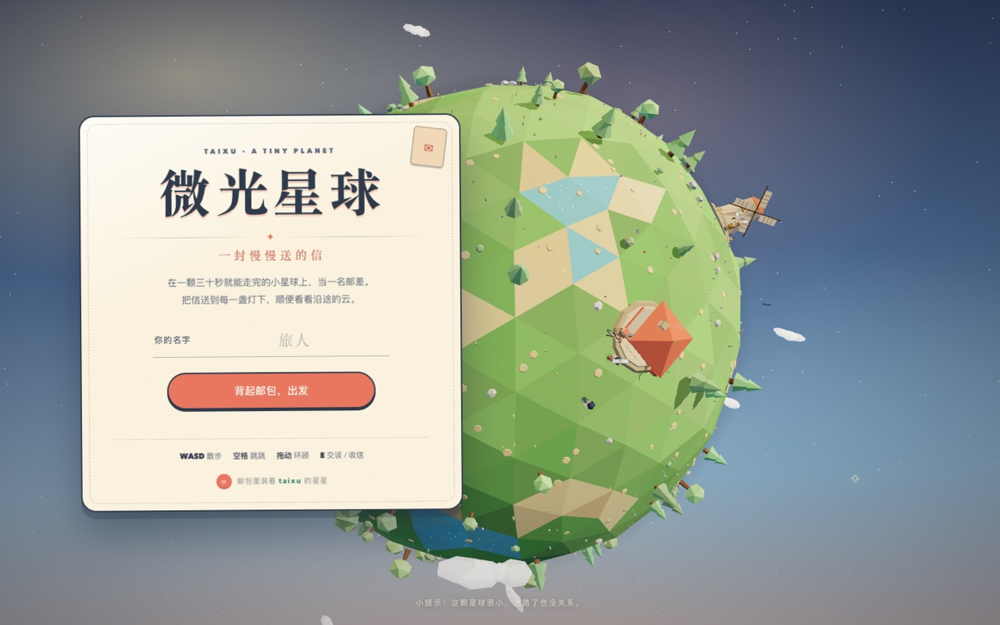
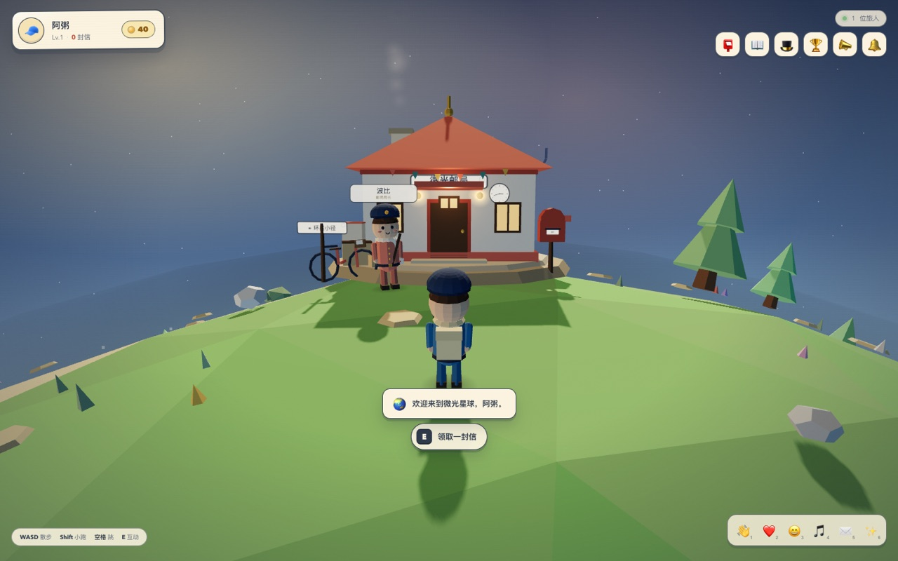
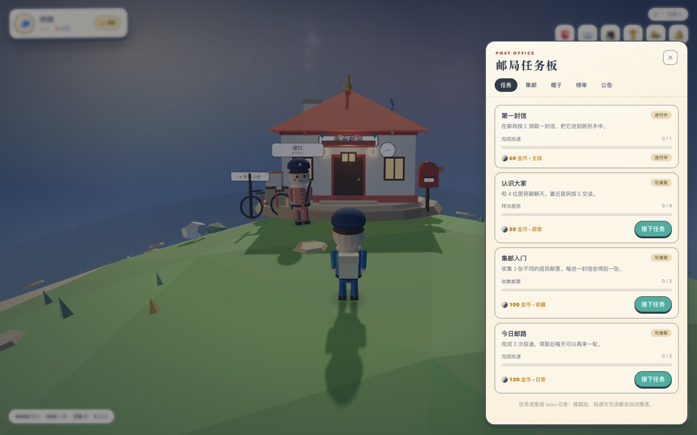
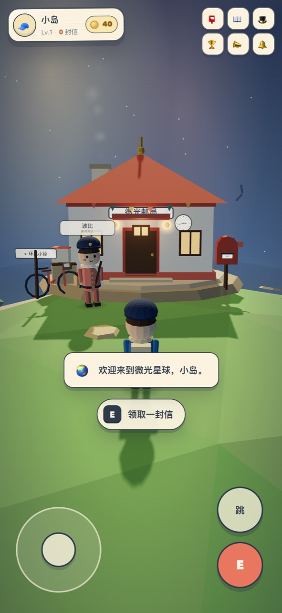

# 微光星球 · Tiny Messenger

> 在一颗三十秒就能走完的小星球上，当一名慢慢送信的邮差。



**微光星球**是一个可以直接在浏览器里玩的小型 3D 送信游戏。你在一颗低多边形小星球上散步、和居民聊天、从邮局领信，把信送到灯塔、风车、海滩、山寺、车站和森林。没有倒计时，也没有失败惩罚——走到哪里算哪里，顺便看看云。

画面与规则受 2025 年浏览器游戏 [Messenger](https://messenger.abeto.co/) 的启发，本项目是一个非官方、独立完成的同人技术练习，所有模型、贴图和音乐都由代码实时生成。



| 任务板 | 手机端 |
| --- | --- |
|  |  |

## 玩法

- 在邮局旁和邮局局长**波比**交谈，按 `E` 领一封信；信上会写着收信人和地点。
- 走到居民身边，再按 `E`，选择「递上信件」。
- 每送出一封信会得到 **35 金币**和一张居民**邮票**，还会推进已接取的任务。
- 打开 `📮` 任务板接取委托；任务完成后来这里领奖。
- 集齐 6 张邮票，在 `📖` 集邮册里领取「星星王冠」。
- 去 `🎩` 帽子铺用金币换草帽、花环或水手帽。
- 送得越多，`🏆` 邮差榜上的名次越高。投递也会获得经验，角色会慢慢升级。
- 数字键 `1`–`6` 发送 3D 表情；其他玩家会在世界里看到。

| 桌面 | 手机 |
| --- | --- |
| `WASD` / 方向键 移动 | 左下摇杆移动 |
| `Shift` 小跑 | 「跳」按钮 |
| `空格` 跳 | 「E」按钮互动 |
| 拖动鼠标环顾，滚轮缩放 | 单指拖动画面环顾 |
| `E` 交谈 / 领信 / 投递 | |
| `T` 任务 · `C` 集邮 · `H` 帽子 · `L` 榜单 · `N` 公告 | 右上角图标 |

小提示：走进水里会变慢，还会激起小水圈；靠近邮局时，镜头会自动避开建筑。

## 运行

只需要 Rust（taixu 要求 **Rust 1.89+**）。Three.js 已经放在 `web/vendor/`，**不需要 Node.js、npm 或任何前端构建步骤**。

```bash
cargo run
# 打开 http://localhost:4321
```

可选环境变量：

```bash
PORT=8080 cargo run                  # 换端口
TAIXU_SNAPSHOT=data/my-world.json cargo run   # 换存档位置
```

第一次启动会在 `data/tiny-planet.json` 生成一颗新星球。想从头开始，停掉服务并删除这个文件即可。

## 项目结构

```text
src/
  main.rs     启动、加载快照、静态文件服务、定时存档
  world.rs    星球地理、7 位居民、taixu 世界目录（道具/任务/成就/商店/图鉴/榜单/公告）
  server.rs   axum HTTP API、登录/投递/交谈、在线状态与心跳
  store.rs    原子写入的 JSON 快照存储（taixu GameStore）
web/
  index.html
  css/style.css
  js/main.js      场景启动、心跳、多人在线、交互编排
  js/planet.js    星球地形、水面、树木、云朵、路径、粒子
  js/landmarks.js 邮局、灯塔、风车、海滩、山寺、车站、森林小屋
  js/character.js 低多边形邮差 / 居民 / 帽子 / 表情
  js/player.js    球面移动、跳跃、镜头、相机避障
  js/ui.js        HUD、对话框、任务/集邮/帽子/榜单/公告面板
  js/audio.js     WebAudio 程序化环境音乐、脚步与音效
  vendor/         Three.js（构建时直接服务，无需联网）
docs/            README 截图
```

## taixu 用在哪里

游戏状态完全由 [`taixu`](https://crates.io/crates/taixu) 的 `Game` 门面管理，宿主（axum）只负责网络、身份和快照：

- **账号与区域**：`ensure_account`、`login`、`heartbeat`、`set_level`。
- **信件与邮票**：`register_item`、`add_item`、`remove_item`、`item_count` 与唯一邮票。
- **金币与奖励**：动态货币 `coins`，`grant_reward`、`add_leaderboard_score`。
- **任务**：`TaskDef` / `TaskObjective::metric`，接取、进度、完成、领奖与每日冷却。
- **成就**：`AchievementDef` + `record_event`，达成后自动领取。
- **集邮册**：`CollectionDef` + 里程碑奖励，最后一件奖励是王冠皮肤。
- **帽子**：`SkinDef` / `equip_skin` / `update_avatar`、限购 `ShopOffer`。
- **排行榜与公告**：`Leaderboard`、`AnnouncementDraft` 和每账号已读状态。
- **持久化**：`Game::snapshot` 经 `FileStore` 原子写入 JSON。

位置同步和在线名单不属于 taixu 的领域：它们由宿主在内存里维护，客户端每 2.2 秒通过 `/api/heartbeat` 上传球面坐标。没有 WebSocket，也没有依赖额外服务。

## HTTP API

| 方法 | 路径 | 说明 |
| --- | --- | --- |
| `GET` | `/api/world` | 星球半径、地点、居民、表情列表 |
| `POST` | `/api/login` | `{ name, account_id? }`，返回玩家完整状态 |
| `GET` | `/api/state` | 当前玩家状态 |
| `POST` | `/api/letter/accept` | 在邮局领一封信 |
| `POST` | `/api/letter/deliver` | 向居民投递，服务端校验距离 |
| `POST` | `/api/talk` | 居民对话，首次拜访记录 meet 事件 |
| `POST` | `/api/tasks/{id}/accept` | 接任务 |
| `POST` | `/api/tasks/{id}/claim` | 领任务奖励 |
| `POST` | `/api/collection/{index}/claim` | 领集邮里程碑 |
| `POST` | `/api/shop/purchase` | `{ offer_id }` |
| `POST` | `/api/avatar/equip` | `{ skin_id }` |
| `POST` | `/api/heartbeat` | 上传位置/朝向/表情，返回附近玩家 |
| `POST` | `/api/announcements/{id}/read` | 标记公告已读 |
| `POST` | `/api/logout` | 标记下线 |

除 `/api/world` 和 `/api/login` 外，请求携带 `X-Guest-Id` 作为访客身份。

## 测试

```bash
cargo fmt --check
cargo clippy --all-targets -- -D warnings
cargo test
```

当前测试覆盖：目录种子完整性、投递与任务/成就领取、商店扣费原子性、集邮里程碑与王冠、快照 round-trip、文件存储 round-trip。浏览器端另外用 Playwright 在桌面和移动尺寸下走过完整投递、任务领奖、帽子购买、双人在线握手与表情流程。

## 已知限制

这是一个单进程的休闲 Demo，而不是生产服务：

- 身份是浏览器 `localStorage` 里的访客 ID，没有密码、会话签名或防伪；位置也由客户端上报。请勿把它当作带账号体系的线上游戏直接部署。
- 在线名单和玩家位置只在内存中，服务重启后清空；货币、背包、任务、集邮、帽子、榜单等由 taixu 快照保存。
- 没有 WebSocket。其他玩家与表情通过 2.2 秒轮询同步，适合这种慢慢走的小游戏。
- 没有账号删除、聊天审核或运营后台；公告和居民内容固定在 `src/world.rs`。
- 整体状态使用一份全量 JSON 快照，适合朋友之间的小世界，不适合大量并发。

## 灵感与致谢

- 灵感来自 **Messenger**（Abeto，Vicente Lucendo 与 Michael Sungaila 开发，Kevin Colombin 音乐）。本项目与其团队没有关联，也未复用其代码或素材。
- 3D：[Three.js](https://threejs.org/)（MIT，已本地内置）。
- 后端：[taixu](https://github.com/paxoscn/taixu) —— 账号、经济、任务、图鉴、排行榜与快照。
- 地形、树木、建筑、角色、云与星空均由代码实时生成；环境音乐和音效由 WebAudio 合成。
